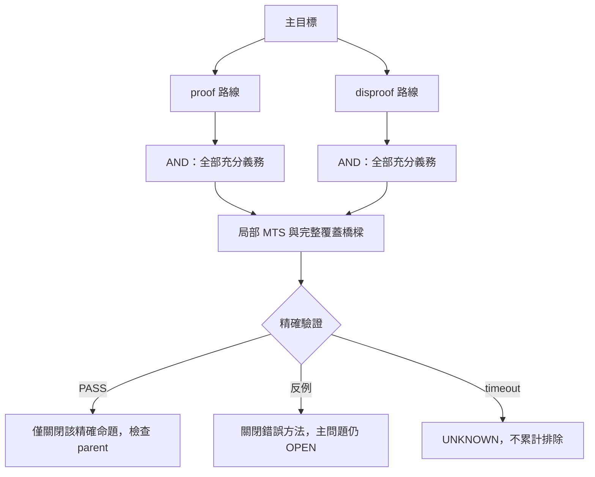

# Sole success condition：主問題 OPEN → CLOSED
2026-11-03。適用 MOLS10 與七維 Cap Set。本文件是目標規約，不是解題聲明。

**唯一成功條件是主問題從 OPEN 變成 CLOSED。**
局部定理、程式、精確證書、對稱分類、掃描數量、分支數和論文，都只是工具。
局部問題可以被解答、錯誤路線可以被關閉，但不得稱為主問題成功或完成百分比。

- MOLS10 CLOSED：完整三個 10×10 Latin squares，精確 100/100/100，獨立驗證；
  或完整非存在性證明，包含所有合法情況、量詞和可重播證據。
- Cap Set CLOSED：找到同一 K 的 K 點有效構造 AND 證明不存在 K+1 點 cap。
  一個 237 點見證只推翻「最大值 236」，不決定 exact maximum。
- FALSE method / UNKNOWN solver / finite samples 不是反命題成立。
- 龐大的完整有限暴力方法必須列出，不能只因時間超過十億年而刪除。
  另一方面，不把有限性的存在當成可行性或速度改善。
- 每個局部工作都要指向根目標的表示法、完整分支、有效上下界或阻塞橋樑。
  橋樑、必要條件、充分條件、對稱覆蓋必須明確，不能用相關性代替。
- 首選用反例推翻猜想的捷徑；被反例推翻後停止同一路的證書堆積。
- 「包圍」的含義：從完整演算法出發，證明大塊候選可安全跳過，且剩餘覆蓋不漏解。
  未發現小型障礙時保留完整枚舉；不預設一定有短證明／小局部矛盾。
- 狀態分開：主問題 OPEN/CLOSED；局部命題 ANSWERED/REFUTED/OPEN；
  執行 PASS/FAIL/UNKNOWN/BLOCKED。不可自動互相提升。
- 工作模式維持現有 user-triggered／automation 設定；本次發佈不啟用任何 automation。

## AND／OR 與 decision graph

對存在性命題 proof/disproof 是 OR；對 exact maximum 每個候選 K 則是
下界與上界的 AND。圖中兩條探索路線不表示數學上需要同時證明 P 和 ¬P。

## 最小可驗證命題 MTS
每張卡必填：ID、parent、精確量詞與範圍、input 版本／hash、推導方向、
必要依賴、驗收謂詞、產物／獨立 checker、負控制、預先固定的 budget、
PASS/FAIL/UNKNOWN 後續動作，以及因此可安全刪除的候選集合。
未找到方法的命題標 GAP，不假裝已拆到最細；budget 限制一次 pilot，不限制最終有限方法的存在。

完整候選清單見 [局部問題目錄](LOCAL_PROBLEM_CATALOG.md)，
完整窮舉基線見 [暴力方法](EXHAUSTIVE_METHODS.md)，
本批程式與證據見 [批次實作](../research/closure_batch/README.md)。
